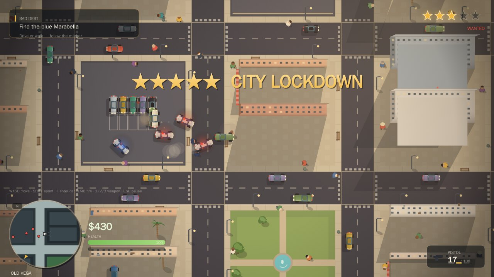
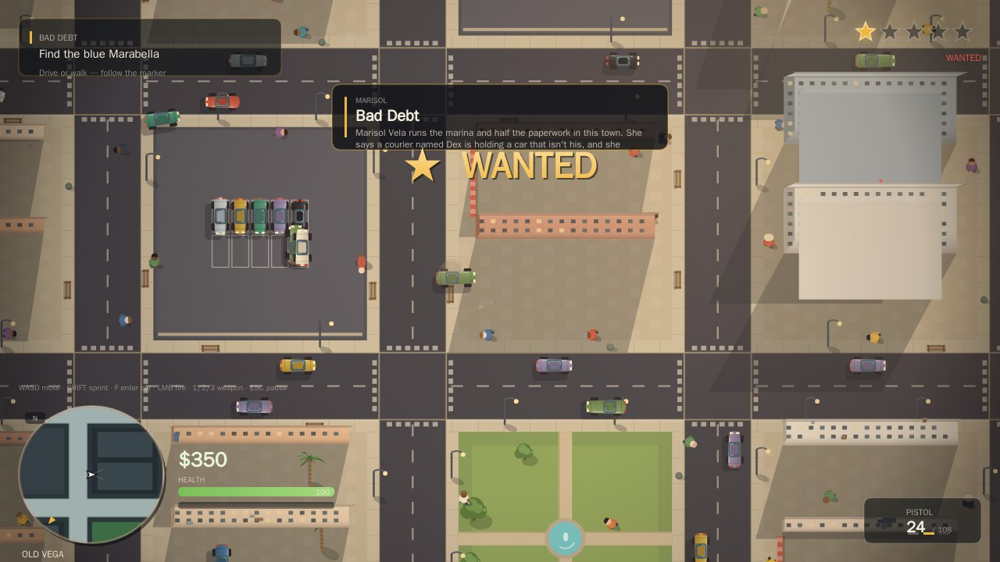
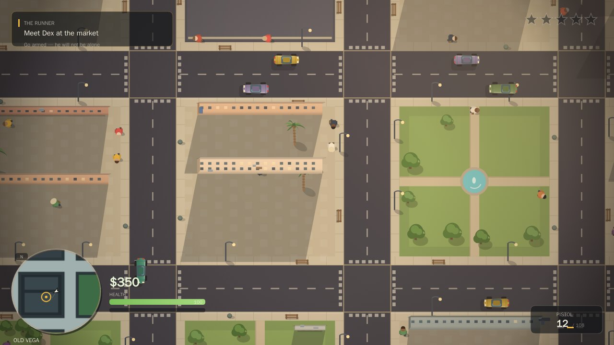
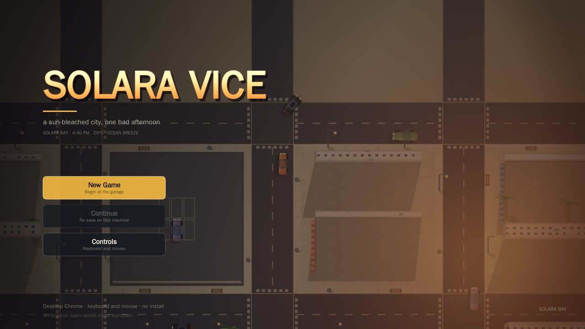

# Solara Vice

[](https://make.fun/bounty/gta6-01?utm_source=github&utm_medium=readme&utm_campaign=gta6-01)
[](https://make.fun/bounty/gta6-01/leaderboard?utm_source=github&utm_medium=readme&utm_campaign=gta6-01)
[](https://make.fun/bounty/gta6-01?utm_source=github&utm_medium=readme&utm_campaign=gta6-01)

An original open-world crime game set in the sun-bleached coastal city of
**Solara Bay**, built for [make.fun's Make GTA 6 bounty](https://make.fun/c/gta6-01).
It runs in desktop Chrome from static files with no network request at all: plain
ES modules, Canvas 2D for the world, and WebAudio for every sound.



## The game

You are a courier in hock to people who do not forgive. The city is a grid of
districts — Old Vega, Solara Heights, the docks — walked on foot or driven
through, with traffic that keeps its lanes, pedestrians that walk the sidewalks
and scatter when you pull a gun, and a police force that answers a rising wanted
level.

- **On foot and by car.** Walk, sprint, climb into any parked or occupied
  vehicle, and drive with acceleration, braking, handbrake turns and tyre smoke.
- **A wanted level.** Five stars of escalation. Patrol cars pursue, officers
  dismount and shoot, roadblocks close in, and the heat only falls once you
  break line of sight and keep out of it.
- **Missions and a story.** Sequential story jobs with briefings, objectives and
  payouts, plus repeatable side work: delivery runs, a street race, a hit.
- **Combat.** Pistol and melee, health and armour, damage, death and respawn.
- **A full HUD.** A live minimap with player heading, police blips and the mission
  marker; health and armour bars, money, wanted stars, weapon and ammo, and the
  objective card.
- **Start, save, pause.** A title screen, localStorage saves with continue, and a
  pause menu.
- **Polish.** A smoothed follow camera with look-ahead, muzzle flashes, sparks,
  smoke and explosions, a daylit palette with long shadows, a damage vignette,
  camera shake, and synthesized effects and music.

## How it is built

`main.ts` hands the entry in: it copies `game/` and `screenshots/` to the output
directory and writes `dossier.json` with the vendored `buildDossier`. The game
itself is a set of ES modules, one job each:

| File | Job |
| --- | --- |
| `game/src/main.js` | Boot, the fixed-step loop, menus and the screenshot scenes |
| `game/src/game.js` | The world: systems, collisions, the event bus, the update |
| `game/src/city.js` | City generation: districts, blocks, buildings, props |
| `game/src/roads.js` | The road network and lane routing |
| `game/src/vehicles.js` | Cars, driving physics, traffic, stealing |
| `game/src/pedestrians.js` | The crowd and its behaviour |
| `game/src/player.js` | On-foot movement, health, weapons, vehicles |
| `game/src/police.js` | Wanted level, pursuit, roadblocks, losing heat |
| `game/src/missions.js` | Story missions and side jobs |
| `game/src/hud.js` | The HUD and the minimap |
| `game/src/render.js` | Drawing the world |
| `game/src/camera.js` | The follow camera |
| `game/src/particles.js` | Muzzle flash, sparks, smoke, explosions |
| `game/src/audio.js` | Synthesized effects and music |
| `game/src/save.js` | Saves in localStorage |
| `game/src/input.js` | Keyboard and mouse |
| `game/src/ui.js` | Title, pause and settings screens |
| `game/src/config.js` | Tuning and palette |
| `game/src/util.js` | Shared math and drawing helpers |

## Play it locally

```sh
node serve.ts
```

Then open <http://localhost:8080>. Serve the folder over HTTP rather than opening
the file directly, since the game is ES modules.

## Screenshots

Taken from the game's own code with a headless browser driving the real rules
forward, never staged or edited:

| | |
| --- | --- |
|  |  |
|  |  |

## Licence

MIT. The city, the characters, the names, the story, the art and the sound are
all original to this entry, with nothing taken from any commercial game.
